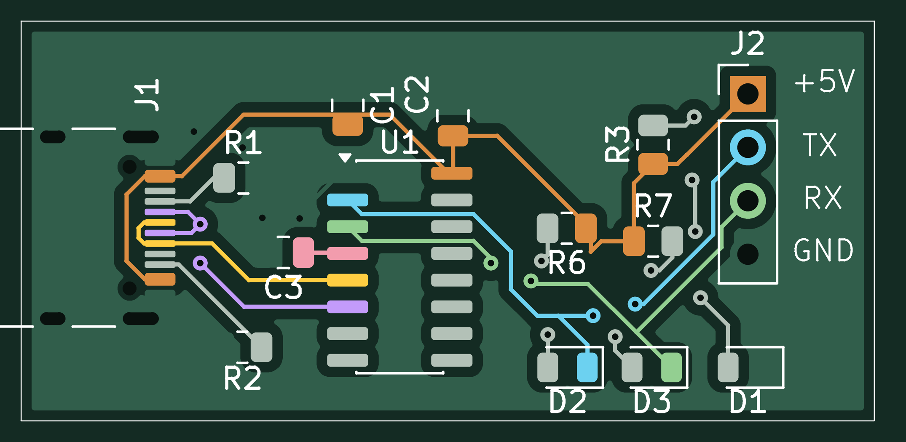
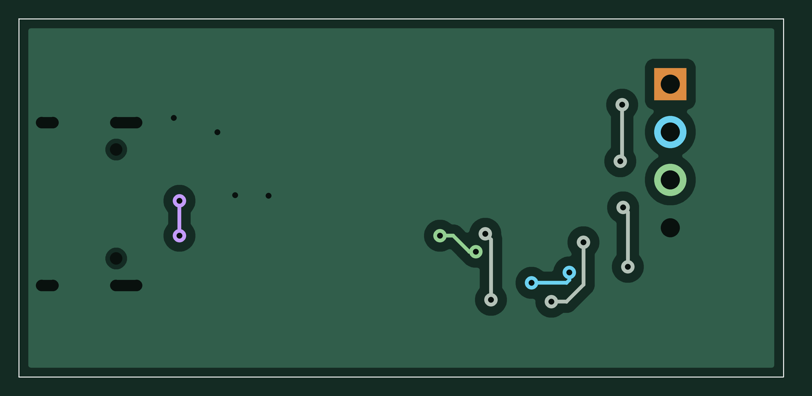
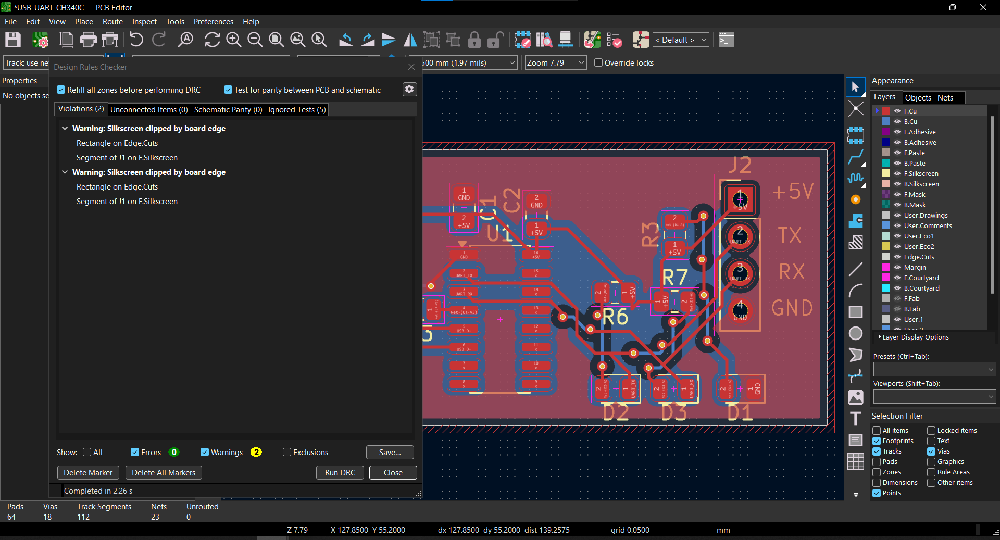

# USB Type-C to UART TTL — CH340C

Đồ án thiết kế mạch chuyển đổi USB sang UART TTL sử dụng **CH340C**, thực hiện trên **KiCad 10**. Mạch kết nối với máy tính qua cổng USB Type-C và đưa tín hiệu UART ra header 4 chân.

**Trạng thái:** đã hoàn thành sơ đồ nguyên lý và bố trí PCB; đang chuẩn bị chế tạo. Chưa có kết quả kiểm thử trên phần cứng đã lắp ráp.

## Hình ảnh PCB

### Lớp đồng trên — F.Cu

### Lớp đồng dưới — B.Cu

Ảnh được dựng từ dữ liệu Gerber, có tô màu để phân biệt các net; đây là ảnh minh họa thiết kế. Cả hai ảnh dùng góc nhìn từ mặt trên, ảnh B.Cu là nhìn xuyên xuống lớp dưới.

## Chức năng thiết kế

- Chuyển đổi USB sang UART TTL bằng CH340C.
- Cấp nguồn 5 V từ USB.
- Đầu nối USB Type-C, dùng các đường dữ liệu USB 2.0 D+ và D−.
- Header UART gồm +5V, TX, RX và GND.
- LED nguồn và LED chỉ thị TX/RX.
- Hai điện trở 5,1 kΩ nối riêng CC1 và CC2 xuống GND.

Mạch được thiết kế cho UART TTL 5 V. Cần kiểm tra khả năng chịu điện áp của thiết bị đích trước khi nối tín hiệu UART.

## Thông số PCB

| Hạng mục | Giá trị trong thiết kế |
|---|---|
| Kích thước theo đường biên Edge.Cuts | 40,5 × 19 mm |
| Số lớp đồng | 2 |
| Độ dày khai báo | 1,6 mm |
| Độ dày đồng khai báo | 35 µm |
| Độ rộng đường mạch | 0,20 mm |
| Via: đường kính ngoài / lỗ khoan | 0,70 / 0,30 mm |
| Số linh kiện | 14 |

## Đầu nối UART — J2

| Chân | Tín hiệu | Chức năng |
|---|---|---|
| 1 | +5V | Đường nguồn 5 V từ USB |
| 2 | TX | Tín hiệu phát từ CH340C |
| 3 | RX | Tín hiệu nhận vào CH340C |
| 4 | GND | Mass chung |

Khi nối với thiết bị khác: TX của mạch nối RX của thiết bị, RX của mạch nối TX của thiết bị và nối chung GND. Việc sử dụng chân +5V phụ thuộc cách cấp nguồn của thiết bị đích.

## Danh sách linh kiện

| Ký hiệu | Linh kiện / giá trị | Kiểu vỏ hoặc đầu nối | Số lượng |
|---|---|---|---:|
| U1 | CH340C | SOIC-16, thân rộng 3,9 mm, bước chân 1,27 mm | 1 |
| J1 | USB Type-C USB 2.0 | HRO TYPE-C-31-M-12 | 1 |
| J2 | Header đực 1×4 | Thẳng, bước chân 2,54 mm, xuyên lỗ | 1 |
| R1, R2 | 5,1 kΩ | 0805 | 2 |
| R3, R6, R7 | 1 kΩ | 0805 | 3 |
| C1 | 10 µF | 0805 | 1 |
| C2, C3 | 100 nF | 0805 | 2 |
| D1 | LED nguồn | 0805 | 1 |
| D2 | LED TX | 0805 | 1 |
| D3 | LED RX | 0805 | 1 |

Danh sách trên lấy từ thiết kế KiCad. Mã đặt hàng cụ thể, điện áp định mức của tụ và màu LED cần được chốt khi mua linh kiện. Đầu nối USB phải khớp footprint đã chọn.

## Tệp dự án

| Tệp / thư mục | Nội dung |
|---|---|
| [hardware/USB_UART_CH340C.kicad_pro](hardware/USB_UART_CH340C.kicad_pro) | Tệp dự án KiCad |
| [hardware/USB_UART_CH340C.kicad_sch](hardware/USB_UART_CH340C.kicad_sch) | Sơ đồ nguyên lý |
| [hardware/USB_UART_CH340C.kicad_pcb](hardware/USB_UART_CH340C.kicad_pcb) | PCB đã bố trí và đi dây |
| [fabrication/Gerber_VN_2026-10-19.zip](fabrication/Gerber_VN_2026-10-19.zip) | Gerber và dữ liệu khoan của bản PCB này |
| [docs/images](docs/images) | Ảnh minh họa lớp đồng |
| [.gitignore](.gitignore) | Danh sách bỏ qua tệp tạm và bản sao lưu khi dùng Git |

Để mở và chỉnh sửa, tải toàn bộ repository, giải nén rồi mở `hardware/USB_UART_CH340C.kicad_pro` bằng KiCad 10 với bộ thư viện tiêu chuẩn.

## Quá trình thiết kế và kiểm tra

Tôi thực hiện dự án USB Type-C sang UART TTL sử dụng CH340C trên KiCad, từ xây dựng sơ đồ nguyên lý, lựa chọn footprint, bố trí linh kiện đến đi dây và đổ đồng PCB.

Trong quá trình hoàn thiện, tôi điều chỉnh thiết kế theo yêu cầu gia công của xưởng, với độ rộng đường mạch 0,20 mm và kích thước via 0,70 mm / lỗ khoan 0,30 mm. Tôi chủ động bố trí phần thân đầu nối USB Type-C nhô ra khỏi mép bo để thuận tiện cắm cáp.

### Kết quả kiểm tra trên KiCad

Tôi đã trực tiếp chạy **Design Rules Checker (DRC)** trên bản PCB cập nhật ngày **19/10/2026**.

**Kết quả: 0 Errors — không phát hiện lỗi theo bộ quy tắc thiết kế được cấu hình tại thời điểm kiểm tra.**

Sau khi hoàn tất kiểm tra, tôi xuất các lớp Gerber và dữ liệu khoan để chuẩn bị gia công PCB.

### Trạng thái dự án

Dự án đã hoàn thành giai đoạn thiết kế PCB và kiểm tra DRC trên KiCad. Tôi sẽ cập nhật ảnh bo mạch thực tế, kết quả nhận cổng COM và kiểm thử giao tiếp UART sau khi chế tạo và lắp ráp.

## Kế hoạch kiểm thử sau lắp ráp

- [ ] Kiểm tra chất lượng mối hàn, chiều IC và LED.
- [ ] Kiểm tra chạm chập nguồn trước khi cấp điện.
- [ ] Xác nhận máy tính nhận cổng COM của CH340C.
- [ ] Kiểm tra UART loopback bằng cách nối TX với RX.
- [ ] Kiểm tra giao tiếp với thiết bị đích và ghi lại baud rate, kết quả đo, ảnh thực tế.

Các mục trên là kế hoạch; kết quả sẽ được cập nhật sau khi có bo mạch thực tế.
